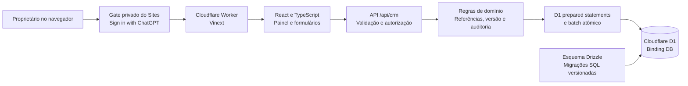
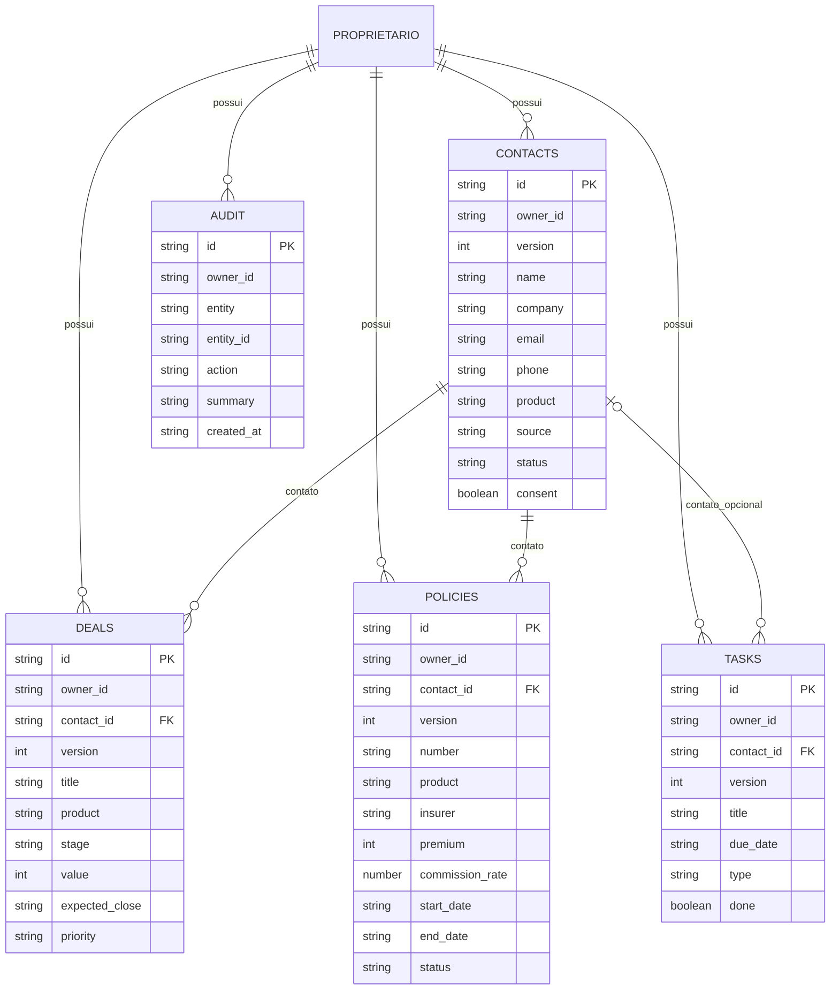
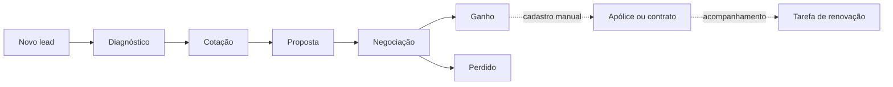

# Arquitetura do CRM Hirayama

Documento da primeira entrega, em português, elaborado em 7 de novembro de 2026. O código e as migrações versionadas são a referência para o comportamento executável. A operação e a recuperação de incidentes estão em [OPERACAO.md](OPERACAO.md).

## 1. Objetivo e fronteira da entrega

O CRM reúne contatos, oportunidades, apólices/contratos e tarefas da Hirayama em uma aplicação privada com persistência no servidor. O atendimento parte do diagnóstico do cliente e acompanha a negociação até a contratação e a renovação.

| Capacidade | Situação nesta entrega |
| --- | --- |
| Cadastro e edição de contatos | Implementado; contato pode representar pessoa ou interlocutor de uma empresa |
| Funil comercial por produto | Implementado; oportunidade vinculada a um contato |
| Carteira de apólices/contratos e vigência | Implementado; cadastro manual |
| Agenda de tarefas e retornos | Implementado; vínculo opcional com contato |
| Histórico de alterações | Implementado no servidor, por proprietário |
| Login | Identidade fornecida pelo Sign in with ChatGPT do Sites |
| Acesso externo | Site privado, restrito ao proprietário na publicação inicial |
| Dados compartilhados entre corretores e papéis de equipe | Fase futura; não há workspace/RBAC nesta versão |
| WhatsApp, e-mail, seguradoras e Formspree | Sem integração operacional nesta versão |
| Cotações em tempo real, emissão e cobrança | Fase futura; valores e apólices são registros de gestão |
| Anexos, arquivos médicos e documentos pessoais | Fora desta entrega; R2 não está ativado |

Os dados de demonstração, quando exibidos, são fictícios. O ambiente publicado não deve receber automaticamente contatos reais nem importar bases anteriores sem uma operação explícita.

## 2. Pesquisa e aderência à Hirayama

Repositórios identificados na conta conectada:

- [HirayamaCorretora](https://github.com/BrandspKauann/HirayamaCorretora): site institucional e origem das linhas de atuação usadas no CRM.
- [hirayama-intelligence](https://github.com/BrandspKauann/hirayama-intelligence): projeto de inteligência/analytics; não foi tratado como um CRM já existente.
- [hirayama-77691](https://github.com/BrandspKauann/hirayama-77691): landing page de seguro de crédito; não é o backend deste CRM.

Evidências no checkout institucional `../hirayama-corretora-clone/`:

| Arquivo | Evidência aproveitada |
| --- | --- |
| `tools/build.mjs`, `contactServiceOptions` | Saúde, crédito, benefícios, consórcio, auto, vida e diagnóstico |
| `tools/build.mjs`, `renderContactForm` | Nome, e-mail, telefone, serviço, mensagem, origem e consentimento |
| `tools/build.mjs`, `formspreeEndpoint` e listener `data-contact-form` | Formulário atual enviado ao Formspree; nenhuma conexão automática com o CRM foi presumida |
| `tools/build.mjs`, `whatsappHref` | Links para abrir WhatsApp; não constituem API de mensagens |
| `tools/build.mjs`, `curatedPartners` | Contexto de seguradoras, operadoras e administradoras |
| `assets/media/hirayama-horizontal-black.png` | Identidade visual da marca |
| `package.json` e `server.mjs` | Site estático, sem modelo CRM persistente existente |

O CRM é um novo aplicativo separado. As páginas institucionais e suas rotinas editoriais permanecem independentes.

## 3. Componentes e decisões técnicas

Foi escolhido um monólito modular: interface e API compartilham tipos, build e implantação, mas os dados são validados e autorizados no servidor. Isso reduz a operação inicial e permite evoluir módulos sem introduzir serviços distribuídos prematuramente.



| Camada | Responsabilidade e referência |
| --- | --- |
| Interface | `app/` e componentes; navegação, formulários, filtros e apresentação |
| Contratos | `lib/crm-types.ts`; tipos de entidades, produtos e estágios |
| API | `app/api/crm/route.ts`; ler snapshot e executar comandos autenticados |
| Domínio e acesso aos dados | `lib/crm-service.ts`, `lib/crm-validation.ts`; validação Zod, autorização, SQL parametrizado e batches D1 |
| Esquema | `db/schema.ts`, `drizzle/`; declaração Drizzle e migrações. `db/index.ts` oferece helper ORM do starter; o serviço atual usa a API D1 diretamente |
| Identidade | `app/chatgpt-auth.ts`; leitura de identidade injetada pelo Sites |
| Entrada de execução | `worker/index.ts`; handler Vinext no Worker |
| Infraestrutura declarativa | `.openai/hosting.json`; projeto e binding lógico D1 `DB` |

O D1 armazena os registros comerciais. O navegador mantém apenas estado de interface ou eventual modo de demonstração; ele não substitui o banco publicado. R2 permanece `null`. O runtime é Cloudflare Workers; código futuro deve respeitar esse ambiente e conexões HTTP, sem presumir um processo Node de longa duração ou acesso TCP direto.

## 4. Modelo de dados

Cada entidade comercial possui `id`, `version`, `createdAt` e `updatedAt` no contrato HTTP. As tabelas também possuem `owner_id`, definido exclusivamente a partir da identidade autenticada, e `mutation_id`, marcador técnico de mutação. Esses campos não são aceitos como escolha do cliente. A entidade lógica proprietário corresponde à identidade do Sites; não existe tabela local de usuários nesta versão.



O diagrama representa o modelo lógico; os nomes físicos devem ser conferidos em `db/schema.ts` e no SQL gerado. O histórico é armazenado em `audit_events`. A tabela técnica `demo_runs` controla a carga de demonstração por proprietário; não representa clientes reais.

| Entidade | Campos funcionais no JSON |
| --- | --- |
| `contacts` | `name`, `company`, `email`, `phone`, `product`, `source`, `status`, `notes`, `consent` |
| `deals` | `title`, `contactId`, `product`, `stage`, `value`, `expectedClose`, `priority`, `notes` |
| `policies` | `number`, `contactId`, `product`, `insurer`, `premium`, `commissionRate`, `startDate`, `endDate`, `status`, `notes` |
| `tasks` | `title`, `contactId`, `dueDate`, `type`, `done`, `notes` |
| `audit` | `entity`, `entityId`, `action`, `summary`, `createdAt`; leitura pelo snapshot |

Convenções:

- `value` e `premium` são inteiros em **centavos de real**. `125000` representa R$ 1.250,00. Não transmitir valores formatados como `"1.250,00"`.
- `commissionRate` é um percentual: `15` representa 15%. Comissão calculada para visualização não representa recebimento conciliado.
- Datas comerciais usam `YYYY-MM-DD`; timestamps de criação/alteração usam ISO 8601. A apresentação diária usa `America/Sao_Paulo`.
- `version` cresce a cada alteração. O cliente deve enviar a versão que leu ao editar ou excluir.
- Contatos têm status `Lead`, `Cliente` ou `Inativo`; apólices têm `Ativa`, `Renovada` ou `Cancelada`.
- Empresa é um texto no contato nesta versão. Normalização de organizações e múltiplos interlocutores pertence à evolução do modelo.
- Uma tarefa pode não ter contato associado; nesse caso, representa uma atividade geral. Oportunidades e apólices exigem contato.
- `notes` é texto livre, limitado a 5.000 caracteres. Não usar esse campo para laudos, doenças, senhas ou arquivos de documentos.

## 5. Jornada e regras comerciais

Produtos aceitos: **Plano de saúde**, **Seguro de crédito**, **Benefícios corporativos**, **Consórcio**, **Seguro auto**, **Seguro de vida** e **Diagnóstico**. São categorias de gestão; seleção de produto não realiza cotação ou contratação junto a terceiros.



O usuário pode ajustar a etapa conforme a negociação. O desenho mostra a sequência recomendada; não pressupõe uma máquina de estados que impeça todo retorno de etapa. Marcar uma oportunidade como ganha não emite uma apólice, não cria cobrança e não dispara mensagem. A conversão em contrato e a tarefa de renovação são cadastros explícitos nesta entrega.

A oportunidade mede uma estimativa comercial; o prêmio da apólice mede o valor informado para aquele contrato. Não somar esses números como se fossem receita recebida. A vigência orienta a lista de renovações, mas nenhuma ação externa acontece automaticamente.

## 6. Contrato HTTP

Todas as operações usam `/api/crm` e exigem identidade válida. O contrato central é orientado a entidades e não expõe SQL. Exemplos abaixo usam exclusivamente dados fictícios.

| Método | Corpo / retorno funcional |
| --- | --- |
| `GET` | Sem corpo; snapshot com `user`, `contacts`, `deals`, `policies`, `tasks` e `audit` |
| `POST` | `{ "entity": "contacts", "data": { ... } }`; cria registro e retorna `{ "record": { ... } }` |
| `PATCH` | `{ "entity": "contacts", "id": "...", "version": 1, "data": { ... } }`; atualiza registro e retorna `{ "record": { ... } }` |
| `DELETE` | `{ "entity": "contacts", "id": "...", "version": 1 }`; exclui conforme integridade e retorna `{ "ok": true }` |

Criação retorna HTTP `201`; leitura, atualização e exclusão bem-sucedidas retornam `200`. Há ainda `POST { "entity": "demo" }`, com retorno `{ "ok": true }` e `201`, para carga explícita de dados fictícios. Ela é permitida uma vez por proprietário e apenas quando todas as tabelas comerciais desse proprietário estão vazias; as demais tentativas recebem `409`. Não é uma rotina de importação de produção.

Exemplo de criação de contato:

```json
{
  "entity": "contacts",
  "data": {
    "name": "Contato de Exemplo",
    "company": "Empresa Exemplo",
    "email": "contato@example.com",
    "phone": "",
    "product": "Plano de saúde",
    "source": "Cadastro manual",
    "status": "Lead",
    "notes": "Solicitou uma conversa inicial.",
    "consent": false
  }
}
```

Exemplo de atualização de oportunidade; `id` e `contactId` devem vir de registros efetivamente retornados pelo servidor:

```json
{
  "entity": "deals",
  "id": "id-retornado-pelo-servidor",
  "version": 1,
  "data": {
    "title": "Plano empresarial — exemplo",
    "contactId": "id-do-contato-do-mesmo-proprietario",
    "product": "Plano de saúde",
    "stage": "Diagnóstico",
    "value": 125000,
    "expectedClose": "2026-12-15",
    "priority": "Média",
    "notes": "Agendar levantamento de necessidades."
  }
}
```

O servidor valida entidade, enumerações, tipos, limites e referências. `PATCH` aceita um subconjunto dos campos funcionais e valida o resultado combinado com o registro atual. Campos desconhecidos são rejeitados. O corpo máximo é 32 KiB. Não confiar na validação de formulário como proteção suficiente. Campos técnicos e de propriedade são definidos no backend. Em erro de validação, a interface mantém o formulário para correção; em conflito de versão, é necessário recarregar os dados antes de uma nova tentativa consciente. Não reexecutar exclusões e atualizações cegamente.

Erros usam `{ "error": "mensagem legível" }`:

| HTTP | Significado |
| --- | --- |
| `400` | JSON, corpo ou campos inválidos |
| `401` | Identidade ausente |
| `403` | Origem ausente ou diferente da origem da requisição |
| `404` | Registro ausente ou pertencente a outro proprietário |
| `409` | Versão desatualizada ou exclusão de contato com dependências |
| `413` | Corpo maior que 32 KiB |
| `415` | Conteúdo da mutação não enviado como JSON |
| `503` | Binding D1 indisponível |
| `500` | Falha interna; mensagem genérica sem SQL ou dados do registro |

O snapshot inclui todos os registros comerciais do proprietário e até **80 eventos de auditoria mais recentes**. Esse limite de leitura não apaga o restante da tabela de histórico. Este endpoint não oferece paginação, integração de máquina, importação em massa ou webhook público nesta versão. O snapshot simplifica a primeira operação; volumes maiores exigirão consultas paginadas e índices orientados pelas medições reais. As respostas usam `Cache-Control: no-store, private` para impedir cache compartilhado dos dados.

## 7. Segurança, isolamento e concorrência

**Identidade e acesso.** O Sites autentica o visitante e injeta cabeçalhos de identidade confiáveis para o Worker. `app/chatgpt-auth.ts` os interpreta. O aplicativo publicado deve ser acessado por esse gateway; um proxy alternativo que aceite cabeçalhos arbitrários do navegador rompe essa fronteira. Login não equivale a permissão de equipe: a publicação inicial é privada e restrita ao proprietário.

**Isolamento por proprietário.** Toda leitura e escrita comercial inclui `owner_id` derivado de `userId`; IDs de outro proprietário não devem permitir leitura, alteração, exclusão ou associação. O identificador do usuário é estável neste Site, não uma chave global entre diferentes Sites. E-mail é informação de exibição, não chave de autorização.

**CSRF e navegador.** `POST`, `PATCH` e `DELETE` exigem `Content-Type: application/json` e `Origin` exatamente igual à origem da URL da requisição. Origem ausente também é rejeitada. A aplicação usa chamadas na mesma origem e não habilita CORS irrestrito. O gate privado, a autenticação da API e a verificação de origem são camadas complementares. Não remover verificações para permitir uma integração futura; criar um canal próprio com credencial e escopo definidos.

**Concorrência otimista.** Uma atualização compara `id`, `owner_id` e `version` no servidor. Se duas abas editarem a versão 1, só a primeira atualização válida deve produzir a versão 2. A outra deve receber conflito, preservar o texto digitado quando possível e pedir recarga/revisão. O mesmo princípio vale para exclusões.

**Integridade e auditoria.** A API valida vínculos com o contato do mesmo proprietário; chaves estrangeiras compostas também protegem o par contato/proprietário no banco. Exclusão usa restrição de dependências, sem cascata silenciosa. A mutação e seu evento de auditoria são executados no mesmo batch atômico do D1. O histórico operacional não é um arquivo legal imutável nem um log criptograficamente inviolável; administradores com acesso ao banco continuam capazes de modificá-lo.

**Segredos e dados.** Esta versão não precisa de senha local nem de chave de WhatsApp. Segredos futuros devem ficar nas variáveis de runtime do Sites, nunca em `.openai/hosting.json`, componentes React, Git ou logs. Não registrar o snapshot, nomes, e-mails, telefones ou conteúdo de notas em logs técnicos. Consentimento é um registro operacional; o checkbox não demonstra por si só adequação jurídica de todo tratamento.

## 8. Implantação e disponibilidade

`.openai/hosting.json` declara o projeto do Sites e `d1: "DB"`; não contém credenciais. O build gera Worker ESM em `dist/server/index.js` e arquivos de cliente. O Sites provisiona o binding e aplica as migrações de produção antes de carregar o Worker. O banco local `.wrangler/state` é separado do banco hospedado.

Esquemas evoluem por novas migrações SQL e snapshots Drizzle. Migrações já aplicadas são imutáveis. Uma publicação que falha pode ter aplicado a migração antes da falha; investigar o estado antes de tentar novamente ou reescrever histórico. Reverter o código não reverte automaticamente o esquema nem os dados.

Não há SLA contratado ou RPO/RTO garantidos nesta entrega. Como proposta de operação futura, iniciar com **RPO de 24 horas** e **RTO de um dia útil**, condicionados a exportação completa diária, cópias externas protegidas e teste real de restauração. Exportação CSV pela interface é parcial e não cumpre sozinha esse objetivo.

## 9. Evolução planejada

1. **Operação comercial:** organizações normalizadas, múltiplos contatos por empresa, anexos privados, propostas estruturadas, motivo de perda e regras de renovação.
2. **Equipe:** workspace, associação de usuários, papéis administrador/gestor/corretor, responsáveis e autorização por registro. A troca de `owner_id` por compartilhamento deve ser uma migração planejada, sem abrir registros existentes a outros usuários.
3. **Integrações:** entrada autenticada de leads com idempotência, assinatura e limites; Formspree e sites institucionais; WhatsApp Business e e-mail mediante configuração específica. Fila, tentativas e caixa de saída devem preceder automações de envio.
4. **Escala:** paginação, busca no servidor, métricas agregadas, retenção de auditoria e índices. Migrar para PostgreSQL apenas quando volume, transações, consultas ou integrações justificarem o custo operacional. Preservar IDs, centavos, versões e escopo de autorização; validar migração por contagens e reconciliação.

Nenhuma fase futura descrita acima constitui funcionalidade já conectada ou serviço ativo.
